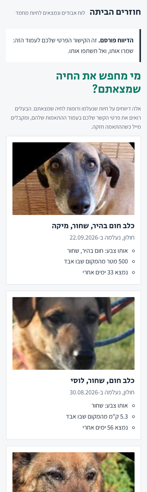
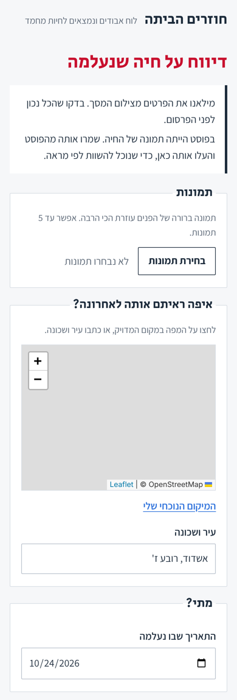

# חוזרים הביתה - Lost & Found Pet Matcher

A Hebrew-first web app that matches lost-pet reports with found-pet reports. A finder uploads a photo; the app compares it with every open lost report by appearance (DINOv2), place and date, explains each match in Hebrew, and emails the owner when the match is strong. People can also upload a screenshot of a Facebook/WhatsApp group post, and Claude fills in the report.

Every step is measured: image models, Claude's extraction, and the final ranking each have an eval with logged results below.

**Demo video:** [`docs/demo.mp4`](docs/demo.mp4): 84 s, phone format, Hebrew captions and Hebrew voiceover. How it's made, and how to re-record it: [`docs/demo-script.md`](docs/demo-script.md).

**Try it in 3 commands** (after the one-time setup further down):

```powershell
python scripts\fetch_dogfacenet.py                 # 8,363 dog photos, ~3 min
python scripts\seed_demo.py --dogs 300 --db demo.db  # 300 lost-dog reports, no API calls
$env:PETMATCH_DB = "demo.db"; uvicorn app:app      # open http://localhost:8000
```

Report one of the photos listed in `demo.db.found.txt` as found, near the place listed next to it, and the right dog comes out on top.

<p>



</p>

## Days 1-2: which image model?

Answers one question with numbers: **when someone reports a found pet, does the real owner's pet show up in the top 5?**

It embeds every photo with an image model, searches for the nearest "lost" photos, and reports recall@1, recall@5 and MRR per model.

| Model | What it is |
| --- | --- |
| `histogram` | Color-histogram baseline, no download. Any real model must beat it. |
| `clip` | OpenAI CLIP ViT-B/32, general image-text model |
| `dinov2` | Meta DINOv2-small, self-supervised; strong on fine visual detail |

## Results so far: DINOv2 wins clearly

DogFaceNet: 1,393 dogs, 8,363 photos; 1,393 found-report queries against a 6,970-photo gallery. Three random splits (seeds 0-2); full history in `results\benchmark_log.csv`.

| Model | recall@1 | recall@5 | MRR |
| --- | --- | --- | --- |
| **DINOv2-small** | **84.6-85.7%** | **94.8-95.5%** | **0.893-0.898** |
| CLIP ViT-B/32 | 56.4-58.1% | 73.0-73.9% | 0.636-0.649 |
| Color histogram (baseline) | 15.7% | 24.5% | 0.203 |

DINOv2 embeds about 26 photos/second on a 2-core CPU, so a single new report takes well under a second.

**Where it fails** (`results\dinov2_misses_sample.png`: found photo, true dog, model's wrong pick): about half the misses are black or very dark dogs; the rest are look-alike mixes (tan, black-and-tan, shepherd types), tilted heads and blurry or dim photos. These are the cases the planned re-rank by attributes, distance and date should fix.

**Caveat:** DogFaceNet photos are cropped, aligned faces. Real lost-pet photos show the whole body from any angle, so expect lower numbers until a face/body detection step and a real-world test set are added.

## Days 3-4: Claude vision extraction

Two jobs, each with a JSON schema Claude must fill (structured outputs, so no parsing guesswork):

- **Describe a pet** from photos: species, breed guess, size, 1-3 colors from a fixed vocabulary, distinctive markings, collar, photo quality.
- **Read a screenshot** of a Hebrew lost/found post into a draft report: lost / found / sighting, species, name, colors, area (Hebrew as written), date (relative dates resolved from the post date), phone (digits only), whether the post has a pet photo.

**Eval set:** `eval\screenshots` holds 40 synthetic Hebrew group posts with an answer key (`labels.jsonl`): 24 lost, 12 found, 4 sightings; 27 dogs, 13 cats; 15 with a DogFaceNet photo; 8 with no phone; dates written as "today", "yesterday", "שלשום" or an explicit date. Synthetic on purpose: real screenshots contain real people's phone numbers. Regenerate or enlarge with `python scripts\make_screenshots.py --n 100`.

**Run it** (needs a Claude API key from [platform.claude.com/settings/keys](https://platform.claude.com/settings/keys); scope it to a workspace when you create it, or also set `$env:ANTHROPIC_WORKSPACE_ID`. Responses are cached, so re-runs are free):

```powershell
$env:ANTHROPIC_API_KEY = "sk-ant-..."
python eval_extraction.py screenshots                      # field accuracy, Haiku 5.5
python eval_extraction.py describe --dogs 30               # do 3 photos of one dog get the same description?
python eval_extraction.py screenshots --model claude-sonnet-5-5   # compare
```

Outputs: `results\extraction_log.csv` (accuracy per field, cost, latency per run) and `results\screenshot_errors_<model>.csv` (every wrong field, truth vs. prediction; opens in Excel with Hebrew intact). Expected cost for both evals on Haiku 5.5: a few cents.

### Results (Oct 25, 2026)

**Screenshots** - 40 Hebrew posts; "all fields" = every scored field right:

| Run | all fields | phone | date | area | colors | cost / 40 posts |
| --- | --- | --- | --- | --- | --- | --- |
| Haiku 5.5, prompt v1 | 82.5% | 92.5% | 97.5% | 97.5% | 92.0% | $0.018 |
| **Haiku 5.5, prompt v2** | **92.5%** | **100%** | **97.5%** | **100%** | **92.0%** | **$0.020** |
| Sonnet 5.5, prompt v2 | 62.5% | 100% | 77.5% | 95.0% | 88.0% | $0.232 |

Report type, species and has-photo were 100% in every run.

- **v1 -> v2:** 3 of 7 v1 errors were phone numbers read backwards. In right-to-left text, "058 555 4552" is *displayed* as "4552 555 058" - the same thing happens in real Hebrew posts. v2 tells Claude about it, and `fix_phone()` repairs any that slip through. v2 also covers sighting dates and drops "באזור" from areas.
- **Haiku beats Sonnet here, at 1/12 the cost.** Sonnet mis-resolved Hebrew relative dates (שלשום, הערב, "ב-1.10"), "corrected" name spellings (גינגר -> ג'ינג'ר) and once took a neighborhood as the pet's name. Decision: Haiku 5.5.
- **Remaining Haiku misses:** one sighting dated null despite "אתמול", one gray cat with no color, one "חום בהיר" read as brown instead of tan.

**Pet descriptions** - Haiku 5.5, 30 dogs x 3 photos, $0.028:

| Field | Same answer across photos of one dog |
| --- | --- |
| species | 100% |
| main color | 92.2% |
| color set (Jaccard) | 73.6% |
| collar | 73.3% |
| size | 93.3% |

Size is "unknown" for 87 of 90 photos, correctly: DogFaceNet shows faces only, so that score says little yet. Collar disagrees because it is visible in some photos and not others, so collar must never be a hard filter in matching.

The **describe** eval needs no labels: it measures whether different photos of the same dog get the same species, size, main color and color set. A description that changes between photos can't help match a lost report to a found one.

## Days 5-6: combined ranking

`petmatch\ranking.py` scores every (found report, lost report) pair:

- **image**: DINOv2 cosine of the best-matching photo pair
- **colors**: soft overlap of Claude's color lists (tan vs brown counts half)
- **place**: `-log(1 + km apart)`; **date**: `-log(1 + days between lost and found)`
- **hard rules**: exclude a clear dog-vs-cat conflict, or a pet "found" more than a day before it was lost

Weights are tuned on half the dogs and tested on the other half. Every match gets a Hebrew reason line, e.g. `פנים דומות מאוד · אותו צבע: שחור · 600 מטר מהמקום שבו אבד · נמצא יומיים אחרי` (see `results\ranking_examples.md`).

**Places and dates are simulated** (`petmatch\simulate.py`): DogFaceNet has none. Lost reports are spread over 15 Israeli cities by population, and each found report is placed and dated relative to its lost one. To show how much the result leans on those assumptions, three scenarios:

| Scenario | Assumption |
| --- | --- |
| base | found ~1.5 km away (10% far), ~3 days later |
| wander | found ~5 km away (25% far), ~7 days later |
| dense | as base, but reports packed into 30 days and tighter neighborhoods |

**Results** - 697 test dogs against all 1,393 lost reports (recall@1 / recall@5):

| Ranking | base | wander | dense |
| --- | --- | --- | --- |
| image only | 85.9% / 94.5% | 85.9% / 94.5% | 85.9% / 94.5% |
| + colors | 86.2% / 94.7% | 86.2% / 94.7% | 86.2% / 94.7% |
| **+ place & date** | **98.4% / 99.7%** | **95.7% / 98.9%** | **95.8% / 99.4%** |
| all | 98.0% / 99.7% | 95.6% / 98.9% | 95.6% / 99.3% |
| no photo: place & date | 30.8% / 64.7% | 7.6% / 27.7% | 9.2% / 33.6% |
| **no photo: + colors** | **54.8% / 81.2%** | **29.7% / 59.5%** | **30.7% / 67.6%** |

What this says:

- **Place and date are the big lever.** Top-1 rises from 86% to 96-98% in every scenario. In 'base', 84 of 98 image-only misses are fixed, including 43 of the 48 black dogs, and none of image-only's hits break.
- **With a photo, colors add nothing**: DINOv2 already sees color. **Without a photo** (a text-only post, 25 of 40 in our screenshot set) colors are the only appearance signal and raise top-5 from 65% to 81% in 'base'. So the app uses two weight sets: photo -> image + place + date; no photo -> colors + place + date.
- The no-photo numbers are optimistic: these colors came from Claude looking at photos, while a text post's colors come from the poster's words.
- **Bug found by the eval:** Haiku labeled a wolf-like dog's species "other", and a strict species rule excluded every candidate for it. Now only a clear dog-vs-cat conflict excludes.

Reproduce (no API calls; descriptions are in `eval\dogfacenet_descriptions.jsonl`, which cost $0.93 on Haiku 5.5):

```powershell
python run_ranking_eval.py
```

## Days 7-8: the app

FastAPI + Jinja2 pages in Hebrew (right-to-left, mobile first), SQLite storage, email alerts.

| Page | What it does |
| --- | --- |
| `/` | Choose "איבדתי" or "מצאתי" |
| `/report/lost`, `/report/found` | Photos, map pin or city, date, colors, contact |
| `/import` | Screenshot of a group post -> prefilled report form to check and publish |
| `/matches/<id>?t=<token>` | The reporter's private page: top 5 candidates with Hebrew reasons |
| `/api/docs` | JSON API (create report, matches, mark reunited, read screenshot) |

**Design decisions worth knowing:**

- **Two weight sets.** Reports with photos rank by image + place + date; photo-less reports by colors + place + date (see Days 5-6).
- **Alerts only when precise.** An email goes out only for a photo match scoring at least 0.65, the strict end of the 99%-precision range measured in `run_ranking_eval.py`. Photo-less matches never reached 95% precision, so they never trigger email; they still appear on the matches page. Known trade-off: a pet found long after it was lost (say 30+ days) still ranks first but scores below the alert line. Recalibrate on real data.
- **Privacy.**
  - Each report gets a private link (a secret token); without it, the matches page and API return 404.
  - Owners see finders' contact details; finders never see owners'. That blocks the "I found your dog, pay for delivery" scam.
  - Public views show place rounded to about 1 km and no contact details.
  - Uploaded photos are re-encoded, which strips EXIF metadata, including the GPS position phones embed.
  - Uploaded screenshots are deleted right after reading; only fields the user confirms are saved.
- **Self-hosted fonts and map library** (`static/`): no requests to Google Fonts or a CDN. Map tiles come from OpenStreetMap.
- **Service layer first.** `petmatch/service.py` holds all logic and is framework-free; `app.py` is a thin layer, so swapping SQLite for Postgres + pgvector touches only `petmatch/store.py`.

**Verified end to end** (headless Chromium against the demo database): a finder's photo of a seeded dog ranked that dog first and triggered the owner email; the post_006 screenshot (phone displayed reversed) imported with the correct phone, area and date.

**Environment variables:** `ANTHROPIC_API_KEY` (photo descriptions + screenshot import; optional), `RESEND_API_KEY` (real email; without it emails print to the console), `PETMATCH_DB`, `PETMATCH_UPLOADS`, `PETMATCH_EMBEDDER` (`dinov2` or `histogram`), `PETMATCH_BASE_URL` (for email links).

## Days 9-10: deploy to Render, free

`render.yaml` describes the whole service, so deploying is a few clicks:

1. Push this folder to a GitHub repository (a fresh repo; `.gitignore` already keeps data, databases, models and keys out).
2. In the [Render dashboard](https://dashboard.render.com): **New > Blueprint**, pick the repository.
3. When Render asks for `ANTHROPIC_API_KEY`, paste a key created only for this server (Claude Console, in a workspace with a monthly spend limit). Never put a key in the repository or a chat.
4. Click **Deploy Blueprint**. The first build takes about 4 minutes: the server packages, the DINOv2 model and a demo database of 300 DogFaceNet dogs. The site then lives at `https://pet-matcher-xxxx.onrender.com`.

**From $25 to $0 a month: DINOv2 on ONNX Runtime.** The first deployment plan needed a 2 GB server ($25/month) because PyTorch plus DINOv2 peaked at about 900 MB. The server now runs the same model through ONNX Runtime ([onnx-community/dinov2-small](https://huggingface.co/onnx-community/dinov2-small)) with DINOv2's preprocessing rewritten in numpy, and never installs PyTorch.

| | PyTorch | ONNX Runtime |
| --- | --- | --- |
| Peak memory, server under load | ~900 MB | **286 MB** |
| Installed packages | several GB | **194 MB** |
| Vectors vs PyTorch | - | cosine > 0.9999 on real photos (`tests/test_onnx_embedder.py`) |
| Render plan needed | 2 GB, $25/month | **free, 512 MB** |

What the blueprint sets up:

| Setting | Value | Why |
| --- | --- | --- |
| Plan | `free` | 512 MB is enough at 286 MB peak. It sleeps after 15 minutes without visitors; the next visit takes about a minute to wake it |
| Storage | none (free plans have no disk) | Every restart starts again from the 300 demo dogs; reports visitors add are lost then. Fine for a portfolio demo |
| Region | Frankfurt | Closest to Israel |
| Claude limits | 20 calls per visitor per hour, 300 per day | A public demo spends your credit; past the limit, reports still save and match by photo |
| Demo mode | `PETMATCH_DEMO=1` | Banner saying it's a demo; seeds the 300 dogs on start |

**To keep reports and stay awake:** in `render.yaml` set `plan: 0.5c-512mb` ($7/month) and uncomment the `disk` block ($0.25/month).

**Rehearsed before shipping:** a fresh clone and a brand-new Python environment built only from `requirements.txt` (no PyTorch anywhere), then `deploy/build.sh` and `deploy/start.sh` exactly as Render runs them. Under 8 simultaneous found-dog reports and 60 simultaneous photo loads, the server peaked at 286 MB with no errors, and all 8 reports ranked the right dog first. After wiping its data and restarting, it reseeded the 300 dogs on its own.

**Bug found while recording the demo:** the matches page loads several photos at once, and a single shared SQLite connection broke under parallel requests: errors, and rows mixed between requests. Fixed with one connection per thread plus SQLite's WAL mode; `tests/test_store_threads.py` reproduces it.

**Not done yet:** real email (add `RESEND_API_KEY`; Resend's test sender only delivers to your own address until you verify a domain), and Postgres if it ever needs more than one server.

## Setup on Windows (one time)

1. Install **Python 3.13** from python.org and tick "Add python.exe to PATH".
2. Unzip this folder, e.g. to `Documents\pet-matcher`, and open PowerShell there.
3. Create a virtual environment and install packages. For the app and the demo only:

```powershell
py -3.13 -m venv .venv
.venv\Scripts\Activate.ps1
pip install -r requirements.txt
```

For the research scripts too (benchmarks with CLIP and PyTorch DINOv2, ranking eval, tests):

```powershell
pip install torch --index-url https://download.pytorch.org/whl/cpu
pip install -r requirements-research.txt
```

If PowerShell blocks the activate script, run once: `Set-ExecutionPolicy -Scope CurrentUser RemoteSigned`.

4. Check everything works (no downloads needed):

```powershell
python -m unittest discover tests
```

## Get photos

**Quick start - your own photos.** One folder per pet, at least 2 photos each (more is better). Photos of single pets with only one photo are welcome too: they act as distractors.

```
data\my_pets\
    bamba\     img1.jpg  img2.jpg  img3.jpg
    shuki\     a.jpg  b.jpg
    neighbors_cat\  x.jpg
```

Vary the photos the way real reports vary: indoor vs. street, side vs. face, night, blurry phone shots.

**Benchmark scale - DogFaceNet (used for the results above, MIT license).** One command downloads it into `data\dogfacenet` (94 MB, about 3 minutes):

```powershell
python scripts\fetch_dogfacenet.py
python run_benchmark.py --data data\dogfacenet --models histogram clip dinov2
```

**More species - PetFace.** Download from the [PetFace project page](https://dahlian00.github.io/PetFacePage/) following its terms (non-commercial research only). Then make a CSV with two columns, `path,pet_id`, one row per image (paths relative to the CSV's folder). Start with dogs and cats.

## Run

```powershell
python run_benchmark.py --data data\my_pets
python run_benchmark.py --csv data\petface\dogs.csv --max-pets 300 --models histogram clip dinov2
```

The first run downloads each model once (roughly 100-600 MB each). Embeddings are cached per photo in `.cache\`, so re-runs and new splits (`--seed 1`) take seconds. On a laptop CPU, expect a few minutes per 1,000 photos.

## Outputs

- **Terminal table** - recall@1, recall@5, MRR and embedding time per model.
- **`results\benchmark_log.csv`** - one row per model per run. Keep it in git: it's your eval history and an interview artifact.
- **`results\misses_<model>.csv`** - every found-report where the true pet was NOT in the top 5. Open the photos and look for patterns (dark fur? side view? similar breed?). That list drives the next improvement.

## How the split works

For each pet with 2+ photos, one random photo is the "found" report (query) and the rest are the owner's "lost" report (gallery). Pets with one photo stay in the gallery as distractors. Results are de-duplicated by pet, because a user sees a list of pets, not photos. `--seed` makes a split repeatable; change it to check the numbers are stable.

## Project layout

```
petmatch\data.py        load folders or CSV, make the query/gallery split
petmatch\embedders.py   histogram, CLIP, DINOv2 (PyTorch) and DINOv2 (ONNX, used by the app)
requirements.txt        server only; requirements-research.txt adds PyTorch for research
petmatch\index.py       in-memory cosine vector index (pgvector replaces it in the API phase)
petmatch\metrics.py     recall@k, MRR, de-duplicated ranks
petmatch\schemas.py     JSON schemas Claude fills + checks against the API's schema rules
petmatch\claude_client.py   Claude API client: structured outputs, retries, cache, cost tracking
petmatch\extract.py     the prompts: describe_pet, read_screenshot
petmatch\scoring.py     field accuracy and description consistency
petmatch\ranking.py     combined ranking, weight tuning, Hebrew match reasons
petmatch\simulate.py    simulated places and dates (assumptions as parameters)
petmatch\service.py     the app's logic: reports, matches, screenshot drafts, alerts (no web code)
petmatch\store.py       SQLite storage; the only file to change for Postgres + pgvector
petmatch\notify.py      email alerts (console or Resend) and the Hebrew email
app.py                  FastAPI pages + JSON API, rate limit, health check
templates\, static\     Hebrew RTL pages, CSS, self-hosted fonts and Leaflet
scripts\seed_demo.py    demo database of lost dogs (no API calls)
scripts\make_voiceover.py  Hebrew voiceover, best-of-N takes judged by Hebrew Whisper
scripts\record_demo.py  records the narrated demo video in sync with the voiceover
render.yaml, deploy\    Render blueprint, build and start scripts
docs\                   demo video, voiceover script, screenshots
run_ranking_eval.py     ranking eval: ablations x scenarios
scripts\describe_reports.py  Claude descriptions for every lost and found report
run_benchmark.py        image-matching benchmark CLI
eval_extraction.py      Claude extraction eval CLI
eval\screenshots\       40 synthetic Hebrew posts + answer key
scripts\fetch_dogfacenet.py  downloads the DogFaceNet benchmark
scripts\make_screenshots.py  generates the synthetic Hebrew posts
tests\                  tests; no model download or API key needed
```
